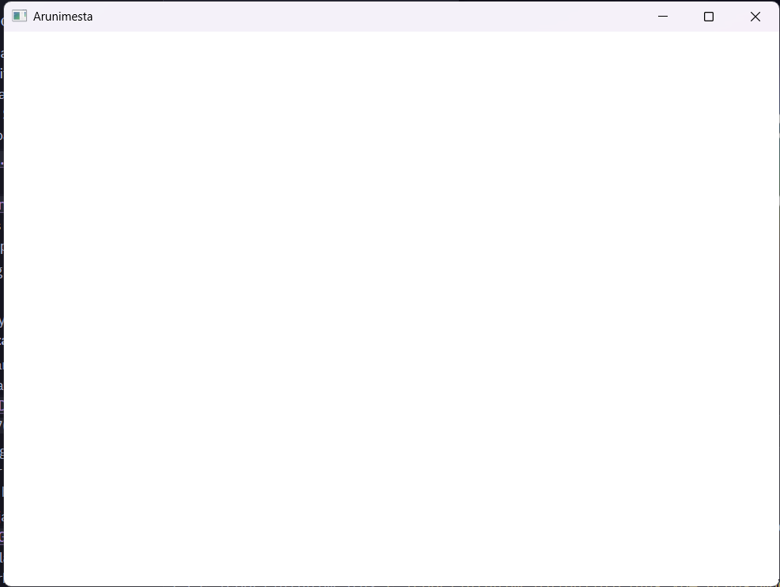
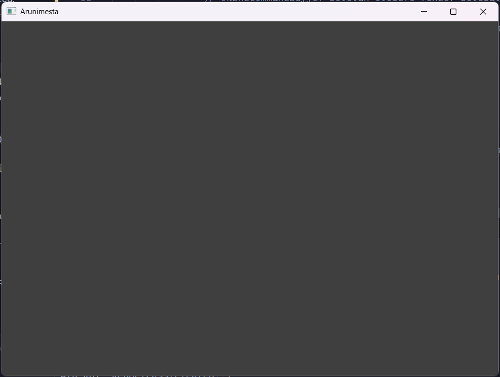

<div align="center">


# Arunimesta Engine


</div>

**Arunimesta** is a 3D game engine built from scratch with **C++23** and *named modules*. The project emphasizes a modular architecture, explicit error handling, and RAII-based resource management.

> **Status: early development.** The build system, the Win32 windowing module (`winaru`), and the Vulkan RHI presentation foundation (`renaru` instance, surface, adapter, device, queue, swapchain, resource views, render pass, framebuffers, command pools, command buffers, and an empty-frame loop with dynamic dispatch) are working. The engine uses the C++ standard library directly (`std::vector`, `std::array`, `std::expected`, `std::optional`, `std::string`, `std::println`) instead of a custom standard module. An empty cleared frame can be submitted and presented; drawing commands and a graphics pipeline have not been implemented yet.

## Preview

<p align="center">
  
</p>

<p align="center"><em>The original empty Win32 window created by <code>winaru</code>.</em></p>

<p align="center">
  
</p>

<p align="center"><em>Current output: the frame loop clears and presents a color attachment. Draw commands are not implemented yet.</em></p>

---

## Project Status

| Area | Status |
| :--- | :--- |
| Build system (CMake + Clang + Ninja) | ✅ Working |
| Module `aru` (facade + `Application`) | ✅ Working |
| Standard library types (`std::expected`, `std::string`, `std::vector`, `std::array`) | ✅ Working |
| Module `winaru` | ✅ Active (Win32 window + blocking event loop) |
| Vulkan RHI (`renaru`) | ✅ Basic (instance, surface, adapter, device, queue, swapchain, resource, render pass, framebuffer, command pool, command buffers, empty-frame loop) |

The `aru` executable creates a Win32 window, a Vulkan instance, surface, adapter, device, graphics/present queue, swapchain with image views, a render pass, one framebuffer per swapchain image, a command pool with one command buffer per image, then pumps Win32 messages with `pollEvents()` while running the frame loop.

---

## Current Features

- **C++23 Named Modules**: the main module `aru` with the module partition `aru:application` and the facade `lib.cppm`.
- **Standard Library First**: sequences use `std::vector<T>` and `std::array<T, N>`; text uses `std::string`, `std::u8string`, `std::u16string`, and `std::u32string`; explicit success/failure uses `std::expected<T, E>`; optional values use `std::optional<T>`; output uses `std::println` / `std::eprintln`. There is no custom standard library module.
- **Factory + `std::expected`**: `Application::init()` returns `std::expected<Application, ApplicationError>` without throwing exceptions.
- **Pimpl with `std::unique_ptr`**: implementation details are hidden in `Application_T`; the object is *move-only*.
- **Heap allocation blocked**: `operator new` is deleted so objects can only be created through the factory and cannot be freely allocated on the heap.
- **RAII**: `Application_T` is cleaned up automatically by `std::unique_ptr`.
- **Debug logging**: `std::println` output is only active in debug builds (`#ifndef NDEBUG`).
- **Win32 windowing**: `winaru` creates and shows a window via `Window::create()`, provides a blocking `event_loop()` and a non-blocking `pollEvents()` for render loops, and exits when the window is destroyed.
- **Unicode window titles**: narrow UTF-8 titles are converted to UTF-16 with `MultiByteToWideChar(CP_UTF8, ...)` and stored as `std::wstring`; a `const char16_t*` overload is available too.
- **CMake Presets**: Clang LLVM x64 presets for Debug and Release, complete with `compile_commands.json` for clangd.
- **Modular structure**: each subsystem is a top-level subproject (`aru/`, `winaru/`, `renaru/`) with its own `CMakeLists.txt`.

---

## Tech Stack

| Component | Technology |
| :--- | :--- |
| **Language** | C++23 (named modules) |
| **Compiler** | Clang (`clang++`) |
| **Build System** | CMake ≥ 3.28 + Ninja |
| **Standard Features** | `std::expected`, `std::optional`, `std::vector`, `std::array`, `std::print` / `std::println`, `std::unique_ptr` |
| **Target Platform** | Windows x64 (matching the available presets) |
| **Standard Library** | C++ standard library only — `std::string` family, `std::vector`, `std::array`, `std::expected`, `std::optional`, `std::println` |
| **Windowing** | `winaru` — Win32 Unicode APIs, window + blocking event loop |
| **Rendering** | Vulkan C API (dynamic dispatch via `renaru::Entry`) — `renaru` instance, surface, adapter, device, queue, swapchain, resource, render pass, framebuffer, command pool, command buffers, frame loop |

---

## Prerequisites

1. **Clang** with C++23 modules support; `clang++` must be available in `PATH`.
2. **CMake ≥ 3.28** — required for `FILE_SET ... TYPE CXX_MODULES`.
3. **Ninja** as the generator.
4. **Windows x64** — the provided presets are only active on Windows.

> The Vulkan SDK is required by `renaru` for the Vulkan C headers. `vulkan-1.dll` is loaded at runtime through `renaru::Entry`, so `vulkan-1.lib` is not linked.

---

## Build

### 1. Clone the Repository

```bash
git clone https://github.com/TsultanDev/arunimesta.git
cd arunimesta
```

### 2. Configure

Debug:

```bash
cmake --preset clang-x64-debug
```

Release:

```bash
cmake --preset clang-x64-release
```

### 3. Build

```bash
cmake --build --preset build-debug
```

or:

```bash
cmake --build --preset build-release
```

### 4. Run

```bash
./build/clang-x64-debug/aru/aru.exe
```

The current demo creates a Win32 window, a Vulkan instance, surface, adapter, device, graphics/present queue, swapchain, image views, a render pass, framebuffers, a command pool, per-image command buffers, then pumps Win32 messages with `pollEvents()` and runs the `acquire → record → render → submit → present` loop.

### Manual Build

If you prefer not to use the presets:

```bash
cmake -S . -B build/clang-x64-debug -G Ninja \
  -DCMAKE_CXX_COMPILER=clang++ \
  -DCMAKE_BUILD_TYPE=Debug

cmake --build build/clang-x64-debug
```

Details and troubleshooting are in [`docs/building.md`](docs/building.md).

---

## Project Structure

```text
arunimesta/
├── .clangd                          # clangd configuration (compile_commands.json)
├── .gitignore
├── CMakeLists.txt                   # Root build script
├── CMakePresets.json                # Clang/Ninja presets (Debug & Release)
├── README.md
│
├── docs/                            # Project documentation
│   ├── README.md                    # Documentation index
│   ├── architecture.md              # Architecture & module design
│   ├── building.md                  # Build guide & troubleshooting
│   ├── coding-style.md              # Code conventions
│   ├── roadmap.md                   # Development plan
│   └── api/
│       ├── application.md           # Application API reference
│       ├── window.md                # Window API reference
│       ├── swapchain.md             # Swapchain API reference
│       ├── resource.md              # Resource tagged union reference
│       ├── render_pass.md           # RenderPass API reference
│       ├── framebuffer.md           # Framebuffer API reference
│       ├── command_pool.md          # CommandPool API reference
│       ├── command_buffer.md        # CommandBuffer API reference
│       └── frame.md                 # Frame loop prototype reference
│
├── aru/                             # Executable — entry point
│   ├── CMakeLists.txt
│   └── src/
│       ├── lib.cppm                 # export module aru; (facade)
│       ├── application.cppm         # export module aru:application;
│       └── main.cpp                 # int main()
│
├── winaru/                          # Static library — windowing (Win32)
│   ├── CMakeLists.txt
│   └── src/
│       ├── lib.cppm                 # export module winaru; (facade)
│       ├── error.cppm               # winaru:error (formattable Error)
│       └── window.cppm              # Win32 window + event loop
│
├── renaru/                          # Static library — Vulkan RHI
│   ├── CMakeLists.txt              # VK_USE_PLATFORM_WIN32_KHR via compile definition
│   └── src/
│       ├── lib.cppm                 # export module renaru; (facade)
│       ├── entry.cppm               # renaru:entry (HMODULE + hot dispatchers)
│       ├── error.cppm               # renaru:error (formattable Error)
│       ├── instance.cppm            # Instance + QueueFlags
│       ├── surface.cppm             # Win32 Surface
│       ├── adapter.cppm             # Physical device selection
│       ├── device.cppm              # Logical device + factories
│       ├── frame.cppm               # Fence/semaphore/frame_index state
│       ├── queue.cppm               # Queue + requestQueue(), submit/present
│       ├── resource.cppm            # Resource tagged union (image/buffer)
│       ├── swapchain.cppm           # Swapchain + image views
│       ├── render_pass.cppm         # RenderPass
│       ├── framebuffer.cppm         # Framebuffer
│       ├── command_pool.cppm        # CommandPool (queue-family pool)
│       └── command_buffer.cppm      # CommandBuffer (primary buffers)
│
├── assets/                          # Logo and documentation images
│   ├── logo.png                     # Project logo (README header)
│   ├── window.png                   # Empty Win32 window screenshot (README, docs)
│   └── color_window.png             # Cleared-frame screenshot (README, frame docs)
├── test/                            # Test area (currently empty)
└── build/                           # Build output (ignored)
```

### Module Descriptions

| Module | Type | Status | Description |
| :--- | :--- | :--- | :--- |
| `aru` | Executable | ✅ | Entry point; imports module `aru`, which re-exports `winaru` and `renaru`. |
| `aru:application` | Module partition | ✅ | `Application` implementation together with the internal `Application_T` details. |
| `winaru` | Static library | ✅ | Win32 window creation, `std::expected`-based errors, move-only ownership, `createFromWindow()`, and event loop. |
| `renaru` | Static library | ✅ | Vulkan C API with `Entry`-owned dynamic dispatch: instance, surface, adapter, device, queue, swapchain, resource, render pass, framebuffer, command pool, command buffers, empty-frame loop with sync objects. |

> `aru` links `winaru` and `renaru`. The `aru` facade re-exports `winaru` and `renaru`. Standard-library types are used directly in every module.

---

## Usage Example

The code currently in `aru/src/main.cpp`:

```cpp
#include <array>
#include <expected>
#include <optional>
#include <print>
#include <string>
#include <vector>

std::optional<int> find(int id) {
    return id == 1 ? std::optional<int>{100} : std::nullopt;
}

std::expected<int, std::string> parse(std::string_view text) {
    if (text == "42") {
        return 42;
    }
    return std::unexpected(std::string("bad input"));
}

int main() {
    std::vector<int> values{1, 3, 4};
    std::array<int, 3> fixed{1, 3, 4};
    std::u16string title = u"Arunimesta";

    values.push_back(5);
    std::println("values={} fixed={} title-length={}",
                 values.size(), fixed.size(), title.size());
}
```

The engine modules use these types in their public APIs: `std::expected<T, Error>` for fallible factories, `std::string_view` / `std::string` for names, and `std::vector<T>` for collections such as swapchain image views.

Application with explicit error handling:

```cpp
import aru;

int main() {
    auto app = aru::Application::init("Arunimesta", 1);
    if (!app) {
        // init() failed
        return 1;
    }

    app->printInfo();
    return 0;
}
```

Window creation with explicit error handling:

```cpp
auto windowResult = winaru::Window::create("Arunimesta — 世界", 800, 600);
if (!windowResult) {
    std::println("Error: {}", windowResult.error());
    return 1;
}
auto window = std::move(*windowResult);

window.event_loop();
```

Narrow titles are UTF-8, so non-ASCII text such as `世界` is supported. `HWND` is a raw handle, so copying is deleted: there is no `window.copy()` and neither copy constructor nor copy assignment is available. Move transfers the handle and empties the source; use `std::move(window)` or move assignment. There is no `move()` member function. To make a real second OS window, use `Window::createFromWindow(window)`.

Vulkan RHI setup (see [`docs/api/swapchain.md`](docs/api/swapchain.md), [`docs/api/resource.md`](docs/api/resource.md), [`docs/api/render_pass.md`](docs/api/render_pass.md), [`docs/api/framebuffer.md`](docs/api/framebuffer.md), [`docs/api/command_pool.md`](docs/api/command_pool.md), [`docs/api/command_buffer.md`](docs/api/command_buffer.md), and [`docs/api/frame.md`](docs/api/frame.md) for the full flow):

```cpp
auto swapchainResult = device.createSwapchain(window.windowWidth(), window.windowHeight());
auto imagesResult = device.createSwapchainImages(swapchainResult.value());
auto renderPassResult = device.createRenderPass(swapchainResult.value());

std::vector<renaru::Framebuffer> framebuffers;
framebuffers.reserve(imagesResult->size());
for (const auto& image : *imagesResult) {
    auto framebufferResult = device.createFramebuffer(renderPassResult.value(), image);
    framebuffers.push_back(std::move(*framebufferResult)); // transfer ownership into the vector
}

auto poolResult = device.createCommandPool(queue);
if (!poolResult) { std::terminate(); }
auto commandPool = std::move(*poolResult);

auto buffersResult = device.allocateCommandBuffers(commandPool, imagesResult->size());
if (!buffersResult) { std::terminate(); }
std::vector<renaru::CommandBuffer> commandBuffers = std::move(*buffersResult);

check(device.acquire([&]() mutable {
    auto& buffer = commandBuffers[device.currentImageIndex()];
    check(buffer.record([&]() {
        check(renderPassResult->render([]() {
            // draw commands will be added here
        }));
    }));
    check(queue.submit(buffer));
    check(queue.present());
}));
```

`check` is a small helper that prints `expected::error()` and terminates; see [`docs/api/frame.md`](docs/api/frame.md) for the full loop and synchronization details.

References: [`docs/api/application.md`](docs/api/application.md), [`docs/api/window.md`](docs/api/window.md), [`docs/api/swapchain.md`](docs/api/swapchain.md), [`docs/api/resource.md`](docs/api/resource.md), [`docs/api/render_pass.md`](docs/api/render_pass.md), [`docs/api/framebuffer.md`](docs/api/framebuffer.md), [`docs/api/command_pool.md`](docs/api/command_pool.md), [`docs/api/command_buffer.md`](docs/api/command_buffer.md), and [`docs/api/frame.md`](docs/api/frame.md).

---

## Documentation

| Document | Contents |
| :--- | :--- |
| [docs/architecture.md](docs/architecture.md) | Module structure, pimpl, ownership, initialization flow |
| [docs/building.md](docs/building.md) | Prerequisites, presets, manual build, troubleshooting |
| [docs/coding-style.md](docs/coding-style.md) | Naming, `.cppm` file layout, factory/pimpl patterns |
| [docs/assets.md](docs/assets.md) | Logo, screenshots, and asset usage rules |
| [docs/api/application.md](docs/api/application.md) | `aru::Application` API |
| [docs/api/window.md](docs/api/window.md) | `winaru::Window` API (Win32, active) |
| [docs/api/swapchain.md](docs/api/swapchain.md) | `renaru::Swapchain` API and image selection |
| [docs/api/resource.md](docs/api/resource.md) | `renaru::Resource` tagged union (image/buffer) |
| [docs/api/render_pass.md](docs/api/render_pass.md) | `renaru::RenderPass` API |
| [docs/api/framebuffer.md](docs/api/framebuffer.md) | `renaru::Framebuffer` API |
| [docs/api/command_pool.md](docs/api/command_pool.md) | `renaru::CommandPool` API |
| [docs/api/command_buffer.md](docs/api/command_buffer.md) | `renaru::CommandBuffer` API |
| [docs/api/frame.md](docs/api/frame.md) | Frame loop prototype and sync state |
| [docs/roadmap.md](docs/roadmap.md) | Milestones and future plans |

---

## Roadmap Summary

- [x] CMake + Clang + Ninja build system
- [x] C++23 named modules and module partitions
- [x] `Application` with a `std::expected` factory and `unique_ptr` pimpl
- [x] Standard-library types only: `std::expected`, `std::optional`, `std::string`, `std::vector`, `std::array`
- [x] Re-enable and implement `winaru`: RAII window creation, move-only ownership, and blocking event loop
- [x] Vulkan RHI: instance, surface, adapter/device, queue
- [x] Vulkan swapchain, image views, resource union, render pass, and framebuffers
- [x] Command pools and per-image command buffers with record lifecycle
- [x] Empty-frame loop with fences, semaphores, and presentation
- [ ] Draw commands, graphics pipeline, and resize handling
- [ ] Event handling and resize
- [ ] Resource management and ECS

Details: [`docs/roadmap.md`](docs/roadmap.md).

---

## Contributing

Contributions are welcome. Start with the [contributing guide](CONTRIBUTING.md), which covers the build, coding style, testing expectations, and pull request process.

- [Code of Conduct](CODE_OF_CONDUCT.md)
- [Security Policy](SECURITY.md) — report vulnerabilities privately, not as public issues
- [Issue templates](.github/ISSUE_TEMPLATE) — bug reports and feature requests
- [Documentation index](docs/README.md)

## License

Arunimesta is released under the [MIT License](LICENSE).

## Notes

- This project is **under active development**; the API and structure may change without backward compatibility.
- The current build presets are specific to **Windows x64 + Clang**.
- The `winaru` module is active on Windows x64; see [its reference](docs/api/window.md) for the current API.
- Window titles are UTF-8 and may contain non-ASCII characters.

---

## References

- [C++23 Modules — cppreference](https://en.cppreference.com/w/cpp/language/modules.html)
- [std::expected — cppreference](https://en.cppreference.com/w/cpp/utility/expected)
- [CMake: C++ Modules](https://cmake.org/cmake/help/latest/manual/cmake-cxxmodules.7.html)
- [Clang C++ Status](https://clang.llvm.org/cxx_status.html)
- [Vulkan Specification](https://registry.khronos.org/vulkan/specs/latest/html/vkspec.html)
