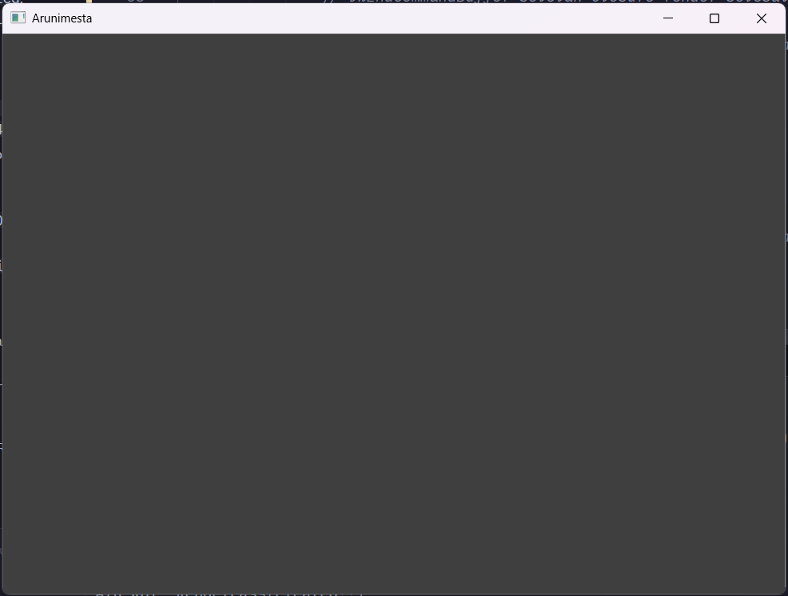

# Frame Loop API Reference

The frame loop is the prototype call chain in `aru/src/main.cpp`:

```cpp
check(device.acquire([&]() mutable {
    const std::uint32_t image_index = device.currentImageIndex();
    auto& command_buffer = command_buffers[image_index];

    check(command_buffer.record([&]() {
        check(render_pass.render(clearColor, []() {
            // Draw commands will be added here.
        }));
    }));

    check(queue.submit(command_buffer));
    check(queue.present());
}));
```

`acquire()`, `record()`, `render()`, `submit()`, and `present()` return `std::expected<void, Error>`. `check` in the demo prints the error and terminates; production code can propagate it instead.

<p align="center">
  
</p>

<p align="center"><em>Output of the prototype loop: the color attachment is cleared and presented. No draw commands are recorded yet.</em></p>

## What Happens Automatically

`Device::acquire(callback)` is implemented in `device.cppm`; its frame state lives in the `renaru:frame` partition (`renaru/src/frame.cppm`):

1. Lazily create `MaxFramesInFlight` (2) image-available semaphores, render-finished semaphores, and in-flight fences. Fences start signaled.
2. Wait on the fence for the current `frame_index`, then reset it.
3. Call `vkAcquireNextImageKHR` with the image-available semaphore and store the returned image index in the device.
4. Run the callback.
5. Advance `frame_index = (frame_index + 1) % MaxFramesInFlight` after the callback.

`CommandBuffer::record(callback)` resets the buffer, calls `vkBeginCommandBuffer`, runs the callback, then calls `vkEndCommandBuffer`. The buffer becomes the device's active command buffer for the duration of the callback.

`RenderPass::render(clearColor, callback)` calls `vkCmdBeginRenderPass` using the framebuffer matching the current image index and the current swapchain extent, runs the callback, then calls `vkCmdEndRenderPass`. `render(callback)` uses the render pass's stored clear color (default `{0.3f, 0.3f, 0.3f, 1.0f}`); `setClearColor()` changes it.

`Queue::submit(buffer)` submits one primary command buffer, waiting on the image-available semaphore and signaling the render-finished semaphore plus the in-flight fence. `Queue::present()` presents the current image after waiting on the render-finished semaphore. `Device::waitIdle()` is called after the loop so the GPU finishes before the sync objects are destroyed.

## Errors

| Error | Meaning |
| :--- | :--- |
| `eFrameAcquisitionFailed` | Sync resources are missing, fence wait/reset failed, or `vkAcquireNextImageKHR` failed. |
| `eCommandBufferRecordingFailed` | `record()` could not reset/begin/end the command buffer. |
| `eRenderPassRecordingFailed` | `render()` could not begin/end the render pass. |
| `eCommandSubmissionFailed` | `vkQueueSubmit` failed or the required sync handles are missing. |
| `eFramePresentationFailed` | `vkQueuePresentKHR` failed or the swapchain/semaphore is missing. |

All are printed as a numeric value.

## Observers

| Function | Description |
| :--- | :--- |
| `std::uint32_t Device::currentImageIndex() const noexcept` | Swapchain image acquired for the current frame. |
| `std::uint32_t Device::frameIndex() const noexcept` | Index of the in-flight slot used by the current frame. |
| `static constexpr std::uint32_t Device::MaxFramesInFlight` | Number of in-flight slots (2). |

## Window Pump

`event_loop()` is blocking, so the render loop uses `Window::pollEvents()` instead. `pollEvents()` drains the currently queued Win32 messages once and sets `isOpen()` to `false` when `WM_QUIT` arrives.

## Status

This prototype presents an empty cleared frame. Drawing commands, graphics pipeline, resize handling, and explicit multi-buffer submission are still future work; see [roadmap.md](../roadmap.md).
