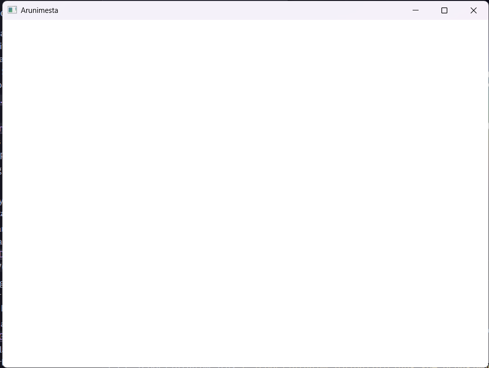

# API: `aru::window::Window`

Reference for the `Window` class exported by module `aru.window`.

```cpp
import aru;          // re-exports aru.window
// or: import aru.window;
// or: import aru.window:window;
```

## Overview

`Window` represents a Win32 window. Instances are created through the `create()` factories, which return `std::expected<Window, Error>` (`Window::ResultType`). The title is stored as `std::wstring` and passed directly to the Unicode Win32 APIs.

<p align="center">
  
</p>

<p align="center"><em>The current window created by <code>aru.window</code>; no rendering is implemented yet.</em></p>

`Window` is move-only: the copy constructor and copy assignment are deleted because `HWND` is a raw handle. The move constructor and move assignment steal the handle and empty the source; use `std::move` to transfer ownership. Creating another real OS window is a separate operation: `createFromWindow()`.

## Error type

```cpp
enum class aru::window::Error {
    None = 0,
    ClassRegistrationFailed = 1,
    WindowCreationFailed = 2,
};
```

Failures are returned as `std::unexpected(Error::X)`.

A `std::formatter<aru::window::Error, char>` specialization is exported, so `Error` can be printed directly:

```cpp
std::println("Error! : {}", err);
```

## API

### `static std::expected<Window, Error> create(const char* title, uint32_t width, uint32_t height)`

Narrow-title overload. The title is treated as UTF-8 and converted to a `std::wstring` with `MultiByteToWideChar(CP_UTF8, ...)` before being passed to `CreateWindowExW`.

```cpp
auto window = aru::window::Window::create("Arunimesta", 800, 600);
if (!window) {
    std::println("Error! : {}", window.error());
    std::terminate();
}
```

### `static std::expected<Window, Error> create(const char16_t* title, uint32_t width, uint32_t height)`

UTF-16 overload; the title is used as-is (mapped to `wchar_t`, which is 16-bit on Windows).

### `static std::expected<Window, Error> createFromWindow(const Window& source)`

Creates a **new OS window** using the source window's title, width, and height. Since copying is deleted, this is the only way to obtain a second window with the same configuration: it calls WinAPI again and produces a distinct `HWND`.

```cpp
auto second = aru::window::Window::createFromWindow(window);
if (!second) {
    std::println("Error! : {}", second.error());
    std::terminate();
}
// second->handle() != window.handle()
```

### Copy is deleted

`Window(const Window&)` and `Window& operator=(const Window&)` are deleted: duplicating a raw `HWND` would produce two owners of the same OS window. Use `createFromWindow()` when a real second window is needed.

### `Window& operator=(Window&& source) noexcept`

Move assignment steals the `HWND`, `HINSTANCE`, title, width, and height. The source window becomes empty (`handle() == nullptr`). There is no `move()` member function; use `std::move`.

```cpp
auto moved = std::move(window);   // window is now empty
```

### `void event_loop()`

Runs the blocking Win32 message loop (`GetMessageW` / `TranslateMessage` / `DispatchMessageW`). `WM_DESTROY` posts `WM_QUIT`, which ends the loop and sets the internal `open` flag to `false`. Calling `event_loop()` again after that returns immediately.

Use `isOpen()` / `shouldClose()` as the main-loop condition so the loop stops when the user closes the window:

```cpp
while (window.isOpen()) {          // or: while (!window.shouldClose())
    window.event_loop();
}
```

### `void pollEvents()`

Non-blocking alternative for render loops. It calls `PeekMessageW(PM_REMOVE)` until the queue is empty, dispatches each message, and sets `isOpen()` to `false` when `WM_QUIT` arrives. This is the variant used by the current demo because `event_loop()` would block rendering until the window closes.

```cpp
while (window.isOpen()) {
    window.pollEvents();
    if (window.shouldClose()) {
        break;
    }
    // acquire / record / render / submit / present
}
```

See [frame.md](frame.md) for the frame-loop prototype.

### Accessors

| Function | Description |
| :--- | :--- |
| `HWND handle() const noexcept` | Native window handle, or `nullptr` when empty. |
| `const std::wstring& windowTitle() const noexcept` | UTF-16 title. |
| `uint32_t windowWidth() / windowHeight() const noexcept` | Configured size. |
| `bool empty() const noexcept` | `true` when `handle() == nullptr`. |
| `bool isOpen() const noexcept` | `true` until `WM_QUIT` is received; `false` for copies and moved-from windows. |
| `bool shouldClose() const noexcept` | Inverse of `isOpen()`. |

## Lifetime and Ownership

| Operation | Status | Notes |
| :--- | :--- | :--- |
| Constructor | Private | Use `create()` / `createFromWindow()` |
| Copy constructor | Deleted | `HWND` is a raw handle |
| Move constructor | `noexcept` | Steals the handle and empties the source; same as `b = std::move(a);` |
| Copy assignment | Deleted | `HWND` is a raw handle |
| Move assignment | `noexcept` | Steals the handle; source becomes empty |
| Destructor | Public | `DestroyWindow` is called only when `hwnd != nullptr` |

The title is a `std::wstring` value member. It is RAII: assigning to or clearing it releases its internal buffer, and the `std::wstring` destructor frees any remaining storage. No manual `delete` on the title is performed.

The window class `ArunimestaWindowClass` is registered on first use. Registration is idempotent: `ERROR_CLASS_ALREADY_EXISTS` is ignored.

## Current Limitations

- No keyboard, mouse, resize, or other input events are exposed.
- `event_loop()` blocks until `WM_QUIT`; use `pollEvents()` for non-blocking render loops. `isOpen()` is the close flag for the outer loop.
- The window class name is fixed to `ArunimestaWindowClass`.
- `Error` does not yet carry the Win32 error code.
- No thread-safety guarantees.

## Compatibility

- Windows x64 with Win32 (`user32`, `gdi32`).
- Requires C++23 (named modules, `std::expected`, `std::println`).
- Imported via `import aru;`, `import aru.window;`, or `import aru.window:window;`.
- No API stability guarantee yet; see [roadmap](../roadmap.md).
