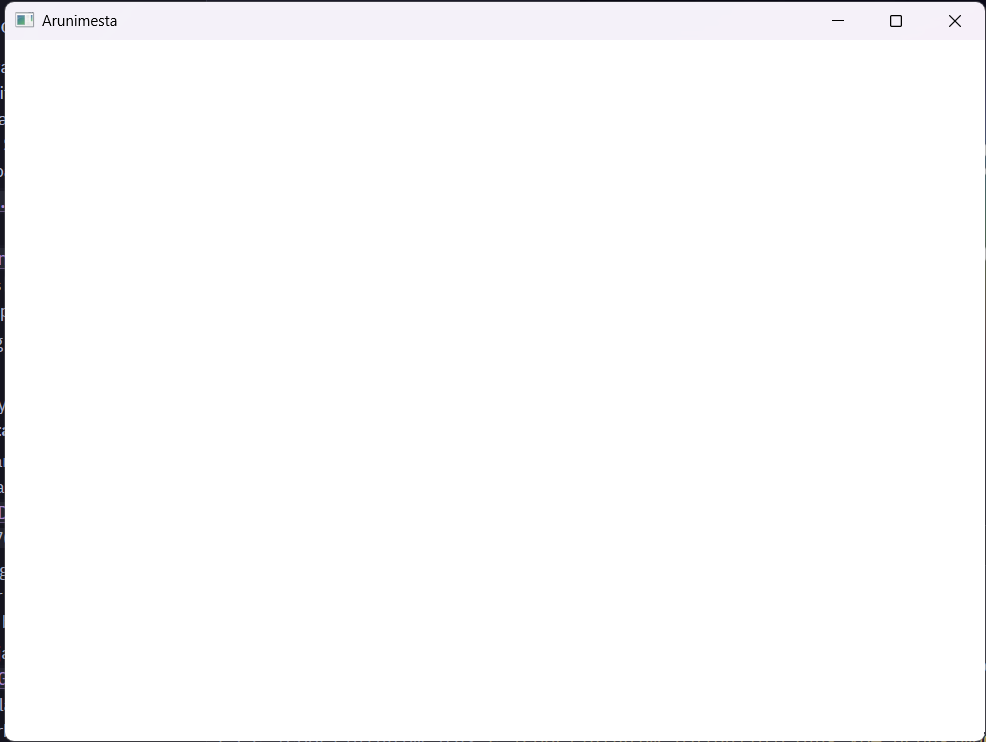
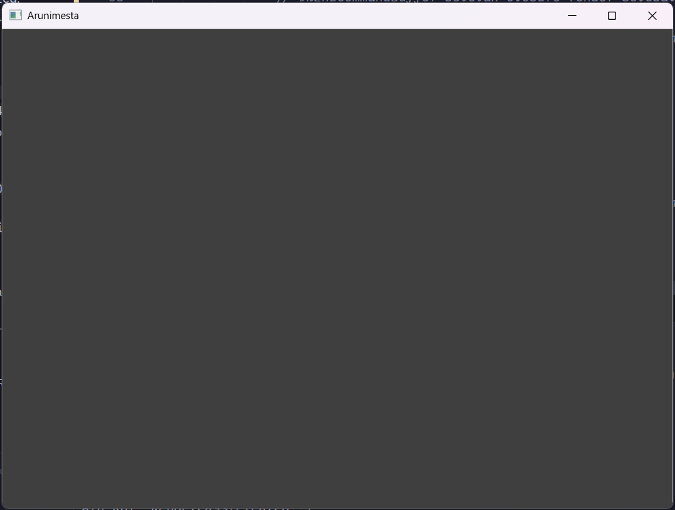

# Assets

This page catalogs the image files committed under `assets/` and where they are used in the documentation. All references use relative paths so the images render on GitHub, in forks, and in local Markdown viewers.

## Logo

<p align="center">
  
</p>

| Property | Value |
| :--- | :--- |
| File | `assets/logo.png` |
| Dimensions | 792 × 800 |
| Format | PNG |
| Used in | [`README.md`](../README.md) header |

The logo is the square project mark shown at the top of the README. Keep it on a transparent or neutral background so it works in both light and dark themes.

## Window screenshot

<p align="center">
  
</p>

| Property | Value |
| :--- | :--- |
| File | `assets/window.png` |
| Dimensions | 986 × 742 |
| Format | PNG |
| Used in | [`README.md`](../README.md) preview, [`api/window.md`](api/window.md) |

The screenshot shows the original empty Win32 window created by `winaru`. It is kept as the baseline before any frame was presented; see `color_window.png` below for the current output.

## Colored frame screenshot

<p align="center">
  
</p>

| Property | Value |
| :--- | :--- |
| File | `assets/color_window.png` |
| Dimensions | 986 × 745 |
| Format | PNG |
| Used in | [`README.md`](../README.md) preview, [`api/frame.md`](api/frame.md) |

This screenshot shows the window after the frame loop submits and presents the cleared color attachment. It confirms that `acquire → record → render → submit → present` works. No draw commands or graphics pipeline are involved yet.

## Usage Rules

- **Relative paths only.** From the repository root use `assets/<file>`; from `docs/` use `../assets/<file>`; from `docs/api/` use `../../assets/<file>`.
- **Keep filenames stable.** If an asset is replaced, update this page and every document that references it.
- **Use PNG for screenshots and logos.** Optimize large images before committing; the logo is currently the largest asset at roughly 360 KB.
- **Describe the image in the alt text.** Examples: `alt="Arunimesta logo"`, `alt="Arunimesta Win32 window"`.
- **Do not use the `assets/` folder for runtime game content yet.** It currently holds documentation images only. Runtime assets (textures, models, shaders) will get a separate layout when the renderer needs them.
- **Respect licensing.** Only add images you created or have permission to redistribute under the project's [MIT License](../LICENSE).

## Adding an Asset

1. Place the file in `assets/` with a lowercase, descriptive name (`logo.png`, `window.png`, `color_window.png`, `swapchain-triangle.png`).
2. Add a row to the appropriate table on this page with dimensions, format, and where it is used.
3. Embed it in the relevant document with an explicit width, for example:
   ```html
   
   ```
4. Verify the image renders in a local Markdown preview and on GitHub.
